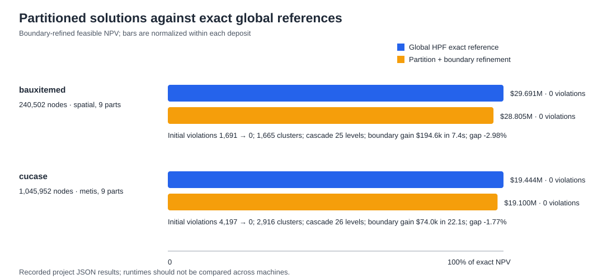
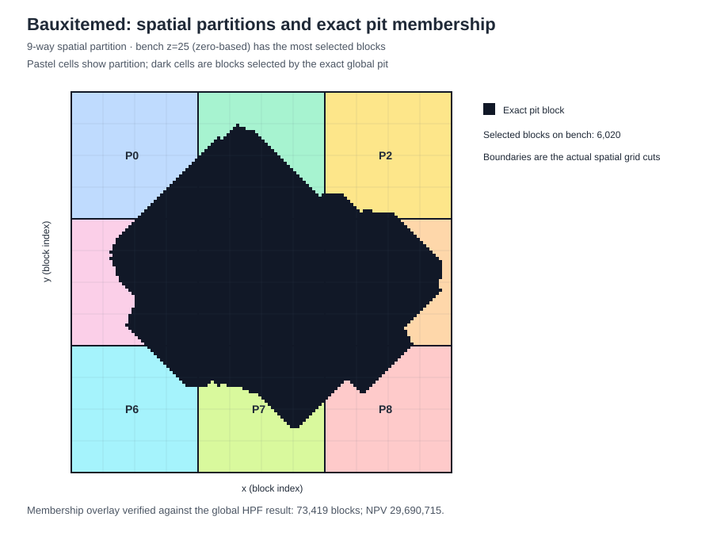
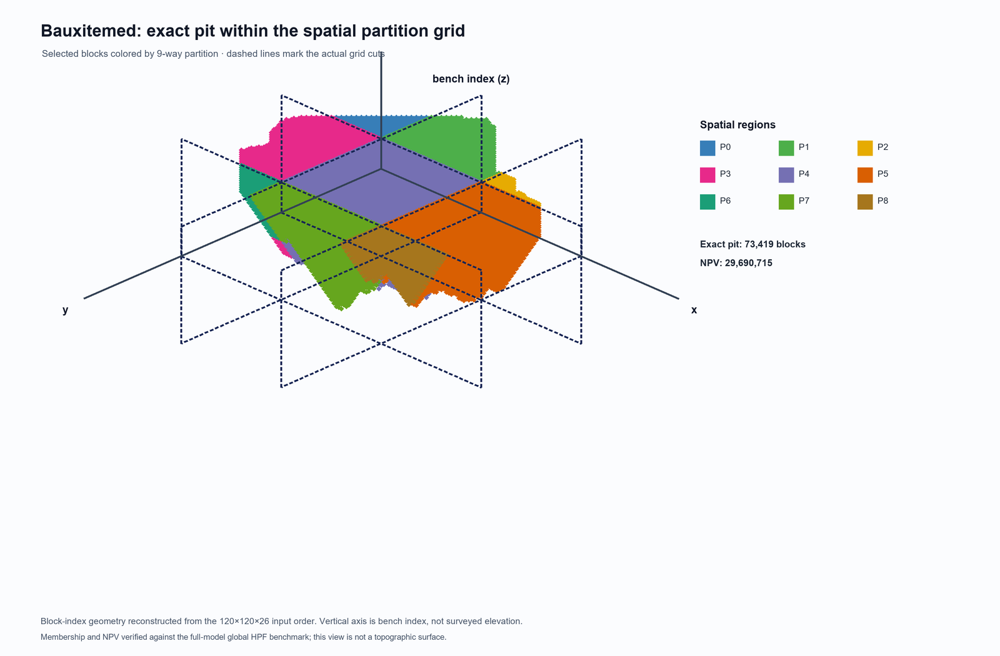

# Consolidated thesis additions: exact comparison, refinement, provenance, and figure

This report consolidates existing experiment outputs; it does not rerun the optimizers. NPV is the input EPV objective used by the closure model, not discounted mine-life cash flow.

## Exact global reference and partitioned feasible result

Global HPF is the exact maximum-closure reference for each dataset. Direct LiteralLG agrees in selected membership and NPV with zero violations. Partitioned results are feasible after boundary refinement but need not be globally optimal.

| Dataset | Nodes | Partition method (k) | Initial violations / clusters | Cascade blocks / depth | Add-only → boundary NPV | Boundary gain / runtime (s) | Final violations | Exact global NPV | Gap to exact |
|---|---:|---|---:|---:|---:|---:|---:|---:|---:|
| bauxitemed | 240,502 | spatial (9) | 1,691 / 1,665 | 10,375 / 25 | 28,610,119 → 28,804,730 | +194,611 / 7.36 | 0 | 29,690,715 | -2.98% |
| cucase | 1,045,952 | metis (9) | 4,197 / 2,916 | 21,031 / 26 | 19,025,532 → 19,099,563 | +74,031 / 22.14 | 0 | 19,444,156 | -1.77% |

The map shows the actual 3×3 spatial partition boundaries and the global exact pit selection on the bench with the most selected blocks. Its membership and NPV are checked against the full-model HPF JSON before generation.

The 3D view uses the exact global pit membership and the Experiment E spatial partition grid. It reconstructs x/y/z block indices from the 120×120×26 input order; z is bench index, not surveyed topography. Regenerate it with `python experiments/build_bauxitemed_3d_block_model.py` (requires Pillow).

The NPV gap is `(partition final NPV / exact global NPV - 1) × 100`; negative values mean the feasible partitioned result is below the exact reference. Bars are independently scaled within each deposit.

## Partition quality measurements

For full bauxitemed Experiment E, the 9-way spatial partition has max/mean size balance 1.557 and 18,800 cut arcs of 1,130,500 (1.663%). Hybrid V4.1 made zero moves and has the same partition metrics. The selected cucase 9-way METIS boundary result does not save balance/cut counts; these are left unavailable rather than inferred from a different partition count or run.

## Reproducibility record

- The experiment notes identify Ubuntu and record SciPy 1.18.1, scikit-learn 1.9.1, and pymetis 2025.2.2 for the full genuine-method Experiment E run.
- Current input paths and SHA-256 values are in `results/thesis_additions_provenance.json`. The hashes were computed while generating this report; original runs did not record them.
- Historical artifacts do not state the Python version, CPU model, or physical memory. Global benchmark JSON records whole-process peak RSS, not solver-specific memory. A fully specified hardware benchmark requires capturing those fields on a rerun.
- Regenerate the comparison, report, checksums, and 2D SVGs from existing results with `python experiments/build_thesis_additions.py`; regenerate the 3D PNG with `python experiments/build_bauxitemed_3d_block_model.py` (Pillow required). Neither command launches an optimizer.

## Source artifacts

- `results/experiment_boundary_refinement_bauxitemed_spatial.json`
- `results/experiment_boundary_refinement_cucase.json`
- `results/experiment_e_hybrid_v4_1_bauxitemed.json`
- `results/global_solver_benchmark_bauxitemed.json`
- `results/global_solver_benchmark_cucase.json`

## Interpretation

Boundary refinement improves the add-only seed on both deposits and restores zero final precedence violations. The bauxitemed spatial result remains about 2.98% below the exact global objective; cucase METIS remains about 1.77% below. These results show feasibility restoration and local objective improvement, not global-optimality guarantees or a speed advantage.
